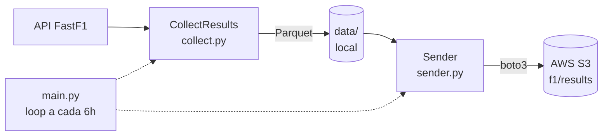

# Data Lake de Fórmula 1
 
> 🚧 **Status:** em desenvolvimento
 
Pipeline que coleta resultados de corridas e sprints de Fórmula 1, grava os dados em **Parquet** e os envia periodicamente para um bucket no **AWS S3**, formando a base de um data lake.
 
## Arquitetura
 

 
## Como funciona
 
1. **Coleta (`collect.py`):** para cada ano e etapa, consulta a biblioteca FastF1 (corrida e sprint) e monta um DataFrame com os resultados dos pilotos, acrescentando metadados do evento (ano, data, rodada, nome do evento, país e local).
2. **Armazenamento local:** cada sessão é salva em um arquivo Parquet, no padrão `ano_etapa_modo.parquet`.
3. **Envio (`sender.py`):** envia os arquivos para o S3 com boto3 e remove o arquivo local depois do upload bem-sucedido.
4. **Automação (`main.py`):** repete o processo de coleta e envio a cada 6 horas, para manter o lake atualizado durante a temporada.
## Decisões de projeto
 
- **Parquet:** formato colunar e compacto, adequado a análises e a data lakes.
- **Coleta parametrizável:** a linha de comando aceita anos e modos, permitindo coletar vários anos de uma vez ou só a temporada atual.
- **Pausas entre requisições:** evitam sobrecarregar a fonte de dados.
- **Credenciais fora do código:** chaves da AWS e nome do bucket ficam em variáveis de ambiente.
## Stack
 
Python · FastF1 · Pandas · Parquet · AWS S3 (boto3) · python-dotenv
 
## Como executar
 
```bash
pip install -r requirements.txt
```
 
Crie um `.env` (não versione):
 
```dotenv
BUCKET_NAME=seu-bucket
AWS_KEY=sua_chave
AWS_SECRET_KEY=sua_chave_secreta
```
 
```bash
# coletar anos específicos
python collect.py --years 2023 2024 --modes R S
 
# enviar para o S3
python sender.py --bucket seu-bucket --bucket_path f1/results --folder data
 
# rodar o ciclo contínuo (coleta + envio a cada 6h)
python main.py
```
 
## Próximos passos
 
- [x] Coleta automatizada com FastF1
- [x] Gravação em Parquet
- [x] Envio para o S3
- [ ] Camadas de tratamento sobre os dados no lake
- [ ] Consultas analíticas
